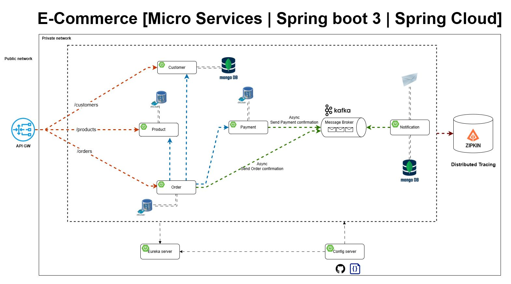

<div align="center">

# NeoShop

### A microservices-based e-commerce platform

[](https://www.oracle.com/java/)
[](https://spring.io/projects/spring-boot)
[](https://react.dev/)
[](https://www.typescriptlang.org/)
[](https://docs.docker.com/compose/)

Browse products, manage a cart, place and track orders, and process payments through a distributed Spring Boot backend.

</div>

---

## Overview

NeoShop is a full-stack e-commerce application organized as independently deployable business services. A React and TypeScript frontend communicates with the backend through a Spring Cloud API Gateway. Services use REST/Feign for synchronous requests and Apache Kafka for asynchronous order and payment events.

The project demonstrates domain-oriented service boundaries, centralized configuration, service discovery, authentication, payment integration, and distributed tracing.

## Features

- **Shopping:** product catalog, categories, search and filtering, product details, guest cart, cart merge after sign-in, and wishlist.
- **Customer accounts:** Keycloak authentication, customer profile, order history, order details, and reviews.
- **Checkout and payments:** order placement with Razorpay or Cash on Delivery (COD).
- **Order lifecycle:** pending, confirmed, shipped, out for delivery, and delivered states. The local scheduler advances order status for development.
- **Notifications:** Kafka-driven order and payment emails, inspectable locally with MailDev.
- **Administration:** product and stock management, image upload, order listing, and order details.
- **Operations:** Eureka discovery, centralized configuration, and Zipkin distributed tracing.

## Architecture



```text
React + TypeScript
        |
        v
   API Gateway <------> Keycloak (OIDC / JWT)
        |
        +---- Customer Service
        +---- Product Service
        +---- Order Service ------> Payment Service
        |          |                      |
        |          +------ Kafka <--------+
        |                    |
        |                    v
        |             Notification Service ---> SMTP
        |
        +---- Review Service

Shared platform: Config Server, Eureka, PostgreSQL, MongoDB, Zipkin
```

- **Synchronous:** Gateway routing and service-to-service calls use HTTP and OpenFeign.
- **Asynchronous:** order, payment, and order-status events flow through Kafka to the Notification Service.
- **Persistence:** PostgreSQL stores relational business data. MongoDB stores notification documents.
- **Identity:** Keycloak issues tokens. The gateway validates JWTs and applies access rules.

### Services

| Service | Responsibility |
|---|---|
| `config-server` | Central configuration |
| `discovery` | Eureka service registry |
| `gateway` | API routing and JWT validation |
| `customer` | Customer and address data |
| `product` | Catalog, categories, stock, and product images |
| `order` | Orders, order lines, tracking, and lifecycle scheduler |
| `payment` | Razorpay and COD payment processing |
| `notification` | Kafka consumers and email notifications |
| `review` | Product ratings and reviews |

### Architecture references

- [Architecture diagram](diagrams/architecture-diagram.jpeg)
- [Entity relationship diagram](diagrams/ERD.png)
- [Domain-driven design diagram](diagrams/DDD.png)
- [Microservices drawing source](diagrams/micro-services.drawio)

## Tech stack

| Layer | Technologies |
|---|---|
| Frontend | React 19, TypeScript, Vite, React Router, Axios |
| Backend | Java 17, Spring Boot 3.4.3, Spring Cloud 2024.0.0 |
| Service communication | Spring Cloud Gateway, OpenFeign, Eureka |
| Messaging | Apache Kafka, Spring Kafka |
| Data | PostgreSQL, MongoDB, Spring Data JPA |
| Security | Keycloak, OAuth 2.0 / OpenID Connect, JWT |
| Payments | Razorpay, Cash on Delivery |
| Observability | Micrometer Tracing, Zipkin |
| Local infrastructure | Docker Compose, Zookeeper, MailDev |

## Requirements

Install the following before starting:

- Java 17
- Node.js and npm
- Docker Engine or Docker Desktop with Docker Compose
- Git

The backend modules include Maven Wrapper scripts. Use `./mvnw` on macOS/Linux or `mvnw.cmd` on Windows. A system Maven installation is optional.

## Quickstart

### 1. Get the source

```bash
git clone <repository-url>
cd NeoShop
```

Replace `<repository-url>` with the URL of your Git repository.

### 2. Start local infrastructure

```bash
docker compose up -d
docker compose ps
```

Compose starts PostgreSQL, MongoDB, Zookeeper, Kafka, Keycloak, MailDev, and Zipkin.

> The Compose file currently uses development credentials and Keycloak's `start-dev` mode. Do not expose this configuration to the internet or reuse these credentials in production.

### 3. Configure external credentials

Razorpay checkout requires valid Razorpay credentials. Set `RAZORPAY_KEY_ID` and `RAZORPAY_KEY_SECRET` in the environment used by the relevant backend service, or configure them through the service's external configuration. Use test-mode credentials for local development. Never commit secrets.

Keycloak realm and client setup must match the issuer and client settings used by the frontend and gateway. The gateway configuration currently expects the issuer `http://localhost:9098/realms/micro-services`.

### 4. Start backend services

Open a separate terminal for each service. Start them in this order so dependent services can find configuration and register with Eureka:

```bash
cd services/config-server
./mvnw spring-boot:run
```

```bash
cd services/discovery
./mvnw spring-boot:run
```

Then start the business services:

```bash
cd services/customer && ./mvnw spring-boot:run
cd services/product && ./mvnw spring-boot:run
cd services/payment && ./mvnw spring-boot:run
cd services/order && ./mvnw spring-boot:run
cd services/notification && ./mvnw spring-boot:run
cd services/review && ./mvnw spring-boot:run
```

Start the gateway after the services:

```bash
cd services/gateway
./mvnw spring-boot:run
```

Run each command from its own terminal, from the repository root. On Windows, use `mvnw.cmd` instead of `./mvnw`.

### 5. Start the frontend

In another terminal:

```bash
cd frontend
npm install
npm run dev
```

Open **http://localhost:5173**.

The API Gateway is configured for **http://localhost:8222**.

## Local endpoints

| Component | URL |
|---|---|
| Frontend | http://localhost:5173 |
| API Gateway | http://localhost:8222 |
| Config Server | http://localhost:8888 |
| Eureka | http://localhost:8761 |
| Keycloak | http://localhost:9098 |
| MailDev inbox | http://localhost:1080 |
| Zipkin | http://localhost:9411 |
| PostgreSQL | localhost:5432 |
| MongoDB | localhost:27017 |
| Kafka host listener | localhost:9092 |

Business-service ports configured in the repository include Customer `8090`, Product `8050`, Payment `8060`, Order `8070`, Notification `8040`, and Review `8061`.

## Usage

1. Open the frontend and browse the product catalog.
2. Sign in through Keycloak to use protected customer features.
3. Add products to the cart, review the cart, and proceed to checkout.
4. Select Razorpay or COD and place the order.
5. Review order history and order details from the customer area.
6. Sign in with an admin account to manage products, stock, and orders.

For local email testing, open MailDev at http://localhost:1080. For request traces, open Zipkin at http://localhost:9411.

The local order scheduler advances orders through `PENDING`, `CONFIRMED`, `SHIPPED`, `OUT_FOR_DELIVERY`, and `DELIVERED`. Its short development intervals are for testing, not production operations.

## Build and test

### Backend

Run tests from each service directory:

```bash
cd services/order
./mvnw test
```

Build a service JAR:

```bash
./mvnw clean package
```

Repeat in the other service directories. Each service is a separate Maven project.

### Frontend

```bash
cd frontend
npm ci
npm run build
npm run preview
```

The build runs TypeScript project checks and creates the Vite production bundle in `frontend/dist`.

The frontend currently defines `dev`, `build`, and `preview` scripts. It does not currently define a test or lint script.

## Deployment

The repository provides Dockerfiles for `config-server`, `customer`, and `discovery`, plus Docker Compose for local infrastructure. It does not currently provide container definitions for every backend service or the frontend.

For a production deployment, create and verify container images for all services and the frontend, then supply production-specific configuration for databases, Kafka, Keycloak, SMTP, Razorpay, service discovery, and tracing. Use managed secrets, secure database credentials, TLS, persistent storage, health checks, and production Keycloak mode. Kubernetes and automated CI/CD are roadmap items, not included deployment workflows.

## Contributing

Contributions are welcome.

1. Open an issue to describe a bug or proposed change.
2. Fork the repository and create a focused branch.
3. Keep changes scoped and follow the existing Java and TypeScript conventions.
4. Add or update tests and documentation with behavior changes.
5. Run the relevant Maven tests and frontend production build.
6. Submit a pull request with a clear summary, test evidence, and any configuration changes.

Be respectful and constructive in discussions and reviews. Do not commit credentials, personal data, generated build output, or local environment files.

## Known gaps and roadmap

### Current gaps

- Most existing backend tests are Spring context-load smoke tests. They do not yet verify core business workflows.
- The frontend has no configured automated test suite or lint command.
- No GitHub Actions workflow is present in the repository.
- Only three backend services currently have Dockerfiles.
- Local Compose credentials, development Keycloak mode, and local service URLs need production overrides.
- The gateway and payment service configuration files currently specify different Keycloak realm names (`micro-services` and `micro-service`). Verify and align the realm before testing authenticated payment flows.
- Keycloak realm/client bootstrap and the complete local secret/configuration contract need a dedicated setup guide.
- A repository-wide one-command launcher and end-to-end verification guide are not currently provided.

### Roadmap

- Add unit, integration, API, and end-to-end tests for checkout, inventory, payments, order transitions, and notifications.
- Add frontend component and browser tests.
- Add CI for Maven tests, frontend checks, and build artifacts.
- Containerize every service and the frontend.
- Add production deployment examples, including Kubernetes.
- Improve centralized logging, metrics, alerting, and production Kafka configuration.
- Add cloud object storage for product images, recommendations, and analytics.

## License

No license file was present in the inspected repository. Add a `LICENSE` file before describing the project as open source or defining reuse terms.

## Author

**Pritam Paul**

Full-stack developer | Java · Spring Boot · React · TypeScript · Microservices
